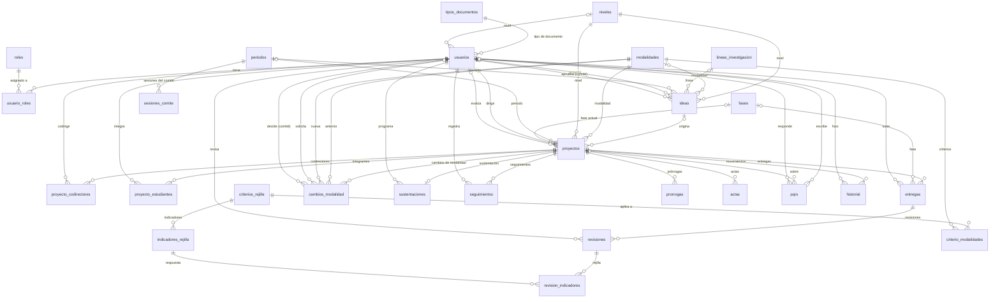

# Base de datos

Última actualización: 2026-10-08 (versión 4, con lo que se tomó de la lista de otro equipo)

- **Base:** `sistemas_proyectos_grado` (MySQL; en local, MariaDB 10.4 de XAMPP), con 28 tablas.
- **Script:** [`bd/sistemas_proyectos_grado.sql`](../bd/sistemas_proyectos_grado.sql). Crea la base, las tablas, los catálogos y los usuarios de prueba.
- **Diagrama entidad-relación:** [`bd/diagrama-entidad-relacion.png`](../bd/diagrama-entidad-relacion.png), con todas las tablas y columnas. Para draw.io: [`bd/diagrama-drawio.txt`](../bd/diagrama-drawio.txt) (se pega en *Extras → Edit Diagram*).
- **Requerimiento:** RNF22 (Tomcat 11 y MySQL). Versión 1 en el Sprint 2; versión 2 en el Sprint 3; versiones 3 y 4 antes del Sprint 4.

## Cómo importarla

1. Encender **MySQL** con Start en el panel de XAMPP.
2. Desde la carpeta del proyecto, ejecutar:

   ```bat
   C:\xampp\mysql\bin\mysql.exe -u root < bd\sistemas_proyectos_grado.sql
   ```

3. Revisar en phpMyAdmin (`http://localhost/phpmyadmin`) que aparezca `sistemas_proyectos_grado`.

**Ojo:** el script **borra la base y la vuelve a crear** desde cero. Si ya tiene datos que importan, haga una copia antes.

## Usuarios de prueba

Todos son ficticios y tienen la contraseña `123456` (desde el 2026-10-08). Usan correos institucionales porque el sistema solo acepta esos dominios (RF1).

| Correo | Rol |
| --- | --- |
| `admin.prueba@uts.edu.co` | Administrador (es el comité de trabajos de grado) |
| `director.prueba@uts.edu.co` | Director |
| `evaluador.prueba@uts.edu.co` | Evaluador |
| `estudiante.prueba@correo.uts.edu.co` | Estudiante (nivel Tecnológico, plan anterior, 80 % de créditos) |
| `docente.prueba@uts.edu.co` | Director y Evaluador (para probar un usuario con varios roles) |

El usuario de Coordinación se quitó en la versión 3, porque Coordinación ya no es un rol.

## Decisiones de diseño

| Decisión | Motivo |
| --- | --- |
| Basada en la base original de la UTS (`sistemastg`), pero sin sus datos | Se toma la estructura y los catálogos institucionales (modalidades, líneas de investigación, tipos de documento); no se copian datos de personas. |
| Sin las tablas de Laravel | El sistema original está hecho en Laravel (PHP); tablas como `migrations`, `jobs` o `sessions` no sirven en un proyecto JSP. |
| 4 roles, y un usuario puede tener varios | Administrador, Director, Evaluador y Estudiante. El administrador es el comité de trabajos de grado (decisión del 2026-10-06). Un docente puede dirigir un proyecto y evaluar otro. |
| Los roles conservan su id (1, 3, 4 y 5); el 2 ya no se usa | El código decide por el id (1 Administrador, 5 Estudiante). Así no hubo que cambiar la lógica al quitar Coordinación. |
| Login con correo institucional y contraseña | Decisión del equipo y RF1. La base solo acepta `@uts.edu.co` y `@correo.uts.edu.co`. |
| Una tabla `proyectos` explícita | En la original los proyectos son "solicitudes" con formularios dinámicos (`campos` y `valores_campos`): es flexible, pero difícil de programar y consultar con JSTL. |
| Contraseñas con `SHA2(clave, 256)` de MySQL | Nunca se guardan en texto plano (RNF4), y JSTL puede generar el hash dentro de la propia consulta. |
| Fechas del periodo en columnas | En la original estaban en un JSON; en columnas son más fáciles de consultar y de cambiar a mano cada semestre (RF3). |
| Un solo proyecto **vigente** por estudiante | El estudiante puede tener proyectos cancelados en su historial y empezar otro (RF38), pero nunca dos vigentes a la vez (RF35). |
| Las reglas que la base puede asegurar van como restricciones | Así se cumplen aunque una página tenga un error: correo institucional, créditos de 0 a 100, director ≠ evaluador, un proyecto vigente, máximo 3 prórrogas, observación obligatoria, nota de 0 a 5, máximo de integrantes entre 1 y 4. |
| Cada columna ENUM lleva `CHECK (columna <> '')` | MariaDB de XAMPP no está en modo estricto: un valor que no está en el ENUM se guardaría como texto vacío, solo con una advertencia. La restricción hace que la base lo rechace. |
| Versiones y versión oficial con columnas que pueden ir en NULL (`entregas.version` y `entregas.oficial`) | Igual que `vigente`: los NULL no chocan en una clave única. Así la base impide dos versiones con el mismo número y dos oficiales del mismo tipo, y los anexos y evidencias (sin versión) se pueden repetir (RF43). |
| La evaluación en borrador va en la misma tabla `revisiones` (`estado`) | La decisión y la observación solo son obligatorias cuando la evaluación está enviada (RF23, RF34). |
| Las rejillas en tablas (`criterios_rejilla`, `indicadores_rejilla` y `criterio_modalidades`) | Están las dos rejillas institucionales: la del F-DC-124 (propuesta: 12 criterios y 28 indicadores) y la del F-DC-129 (informe final: 17 criterios y 40 indicadores); la columna `formato` dice de cuál es cada criterio. La respuesta se marca en cada indicador. Si un formato cambia, se cambian filas sin tocar el código. |

## Diagrama

La imagen completa, con las columnas, está en [`bd/diagrama-entidad-relacion.png`](../bd/diagrama-entidad-relacion.png). Aquí solo van las relaciones: `||` exactamente uno, `|o` cero o uno, `o{` cero o muchos.



## Tablas

### Catálogos

| Tabla | Para qué | Datos iniciales |
| --- | --- | --- |
| `roles` | Los roles del sistema | Administrador (comité), Director, Evaluador, Estudiante |
| `tipos_documentos` | Tipo de documento del usuario | Tarjeta de identidad, Cédula de ciudadanía, Cédula de extranjería |
| `niveles` | Nivel del estudiante y de la idea (RF25, RF40) | Tecnológico, Ingeniería |
| `modalidades` | Modalidades de grado (RF4), con su máximo de integrantes (RF36) | Las 5 del reglamento sin Práctica: Proyecto de investigación y Desarrollo tecnológico hasta 3; Monografía, Emprendimiento y Seminario hasta 2 |
| `lineas_investigacion` | Líneas de investigación | Las 4 de la original |
| `fases` | Fases del proyecto (RF37) y el formato de cada una, como en el sistema actual de la UTS | 0 Aprobación de la idea, 1 Pago, 2 Propuesta I (FDC-124), 3 Propuesta II (FDC-124), 4 Informe I (FDC-125), 5 Informe II (FDC-125), 6 Fase final (sustentación). El `id` no es el número de la fase: el número es `orden` |
| `festivos` | Festivos de Colombia para contar los días hábiles de los plazos (RNF19) | Los 18 festivos de 2026 (hay que agregar los de cada año) |
| `criterios_rejilla` | Criterios de las rejillas (RF23), con su formato | Los 12 del F-DC-124 versión 2.0 (ficha técnica, descripción del problema, justificación, objetivos, estado del arte, fundamento teórico, resultados esperados, plan de actividades, presupuesto, consideraciones éticas, referencias bibliográficas y resumen de similitud) y los 17 del F-DC-129 versión 2 (formato, resumen, introducción, planteamiento de la problemática, justificación, objetivos, estado del arte o antecedentes, marcos referenciales, desarrollo del trabajo, resultados, conclusiones y recomendaciones, consideraciones éticas, referencias, anexos, certificados, sustentación e índice de similitud) |
| `indicadores_rejilla` | Indicadores (preguntas) de cada criterio, que marca el evaluador (RF23) | Los 28 del F-DC-124 y los 40 del F-DC-129, transcritos tal cual (`docs/requerimientos.md`, anexos J y K) |
| `criterio_modalidades` | Qué criterios aplican a cada modalidad (RF23) | F-DC-124: todos, menos el estado del arte en Monografía y Emprendimiento; Seminario no usa este formato. F-DC-129: todos a todas (el evaluador marca N/A lo que no aplique) |

### Usuarios

| Tabla | Para qué | Requerimientos | Reglas que aplica la base |
| --- | --- | --- | --- |
| `usuarios` | Nombre completo, documento (la cédula del docente), correo (login), contraseña, celular. Para estudiantes: nivel, carrera, plan de estudios (anterior o nuevo), % de créditos, si aprobó Metodología y puntaje de Saber TyT (solo tecnología; ingeniería presenta Saber Pro, que no está en el sistema) | RF1, RF7, RF24, RF29, RF33, RNF14 | **Solo correos institucionales**; créditos de 0 a 100; plan Anterior o Nuevo; Metodología 0 o 1; correo y documento únicos |
| `usuario_roles` | Qué roles tiene cada usuario | RF7, RF8 | |

### Ideas y proyectos

| Tabla | Para qué | Requerimientos | Reglas que aplica la base |
| --- | --- | --- | --- |
| `periodos` | Calendario de cada semestre: estado (planeado, activo o cerrado), inicio, cierre del banco (semana 4), límite de pago (semana 8), límite de propuestas (semana 12) y fechas del informe final | RF3, RF25, RF30, RF32 | Nombre de periodo único; estado Planeado, Activo o Cerrado |
| `ideas` | Banco de ideas: las registran los docentes, o es la propuesta propia de un estudiante (`origen`); las aprueba el comité (el administrador) | RF10, RF25, RF29 | Origen Docente o Estudiante; estado Pendiente, Aprobada, Rechazada o Tomada |
| `proyectos` | Código, título, modalidad, nivel, fase, estado, si es interdisciplinario, director, evaluador, fecha de aprobación del FDC-124, fecha de notificación al estudiante (dato del F-DC-124) y fecha límite (180 días desde la aprobación del FDC-124) | RF2, RF6, RF9, RF11, RF12, RF13, RF27, RF31, RF38–RF40 | **Director ≠ evaluador**; código único; estado incluye Cancelado |
| `proyecto_codirectores` | Codirectores de los proyectos interdisciplinarios | RF13 | Un docente no se repite en el mismo proyecto |
| `proyecto_estudiantes` | Integrantes de cada proyecto, con su exoneración por Saber TyT | RF35, RF36, RF38, RNF14 | **Un solo proyecto vigente por estudiante**; solo renuncia a la exoneración quien fue exonerado |
| `entregas` | Archivos: propuesta, FDC-124, FDC-125, FDC-129, reporte Turnitin, recibo de pago, anexos y entregables de la modalidad (evidencias, manual de usuario, código fuente), con su versión y cuál es la oficial | RF21, RF26, RF29–RF31, RF43, RNF15, RNF16 | **Una sola versión N y una sola oficial por tipo** en cada proyecto; versión desde 1 |
| `revisiones` | Aprobaciones en orden director → evaluador → comité, con nota y observación; la evaluación puede estar en borrador | RF14, RF18, RF22, RF23, RF34, RF42 | **Observación y decisión obligatorias al enviar**; estado Borrador o Enviada; decisión Aprobado, Aplazado, No aprobado o Devuelto (F-DC-124); nota de 0 a 5 |
| `revision_indicadores` | Respuestas de la rejilla en cada evaluación: Cumple Sí, No o N/A en cada indicador, con su observación | RF23 | Cada indicador una vez por evaluación; Sí, No, N/A (solo F-DC-129) o sin responder (borrador) |
| `cambios_modalidad` | Solicitudes de cambio de modalidad: anterior y nueva, quién la pidió y cuándo, decisión del comité, quién decidió y cuándo | RF12 | La modalidad nueva es distinta de la anterior; aprobada o rechazada solo con quién y cuándo decidió |
| `seguimientos` | Seguimientos del director antes del informe final | RF20 | Observación obligatoria |
| `prorrogas` | Prórrogas (1, 2 o 3) y su nueva fecha límite | RF38 | **Máximo 3 por proyecto** (F-DC-124) |
| `actas` | Actas del comité por proyecto | RF16 | |
| `sesiones_comite` | Calendario de sesiones del comité de cada periodo: fecha, hora y lugar | RF3, RF16 | Una sesión por día en cada periodo |
| `sustentaciones` | Sustentación del proyecto (fase final): fecha y hora, lugar o medio, y quién la programó | RF39 | Una por proyecto (si se reprograma, se actualiza); lugar obligatorio |
| `pqrs` | PQR en cualquier fase (por ejemplo, cambio de director o evaluador) con su respuesta | RNF1 | Estado Pendiente o Respondida |
| `historial` | Movimientos de cada proyecto: quién, qué (tipo de acción y descripción) y cuándo | RF5, RF37, RNF12 | Acción Estado, Fase, Documento, Evaluación, Decisión, Modalidad u Otro |

### Reglas que controla la aplicación (no la base)

- Integrantes: hasta `modalidades.max_integrantes`; si el proyecto es interdisciplinario, hasta 4 y con un máximo de 2 codirectores (RF13, RF36).
- Plazos: la propuesta se aprueba dentro de las primeras 12 semanas (RF30); el FDC-125 se entrega como mínimo 90 días después de aprobada la propuesta (`fecha_aprobacion_124`) y como máximo 180 días después de esa aprobación (RF31); el evaluador tiene 3 días hábiles para la propuesta y 5 para el informe final, y el director 5 días (RF21), contando los días hábiles con la tabla `festivos` (RNF19); la prórroga se pide antes del vencimiento, unos 8 días antes (RF38).
- Si se vencen todas las prórrogas, se cancela la modalidad y el estudiante presenta una propuesta nueva (RF38).
- Si el informe final no se aprueba, se devuelve para corrección y el estudiante tiene hasta antes del vencimiento (RF22).
- El director registra al menos 2 seguimientos antes de la entrega del informe final (RF20).
- El estudiante de tecnología no puede elegir ideas de ingeniería (RF25).
- El estudiante no ve a su evaluador (RF27).
- Archivos: solo .docx y .pdf, de hasta 15 MB (RNF15, RNF16).
- Estímulos por Saber TyT según el puntaje (RNF14): se calculan con `usuarios.puntaje_saber_tyt`.
- Rejilla del F-DC-124 (RF23): la evaluación solo se envía con todos los criterios de su modalidad respondidos, y "Aprobado" exige que todos estén en Sí. Al enviar, el estudiante y el director ven las observaciones.
- Versiones (RF43): la versión nueva es la siguiente a la mayor del proyecto y el tipo; al aprobarse, se marca como oficial.
- Cambio de modalidad (RF12): solo antes de aprobar el FDC-124; al aprobarse, se cambia `proyectos.modalidad_id` y queda en el historial.
- Banco de ideas (RF25): después de `periodos.fecha_cierre_banco` no se pueden tomar ideas.
- Habilitación (RF33): con el plan de estudios, el % de créditos y `metodologia_aprobada` se decide qué modalidades puede tomar el estudiante y qué requisito le falta.
- Avisos de vencimiento y de cada movimiento (RF5): se muestran **dentro del sistema**, sin correo (decisión del profesor). Para eso, en el Sprint 7 se agregará una tabla de avisos.

## Pruebas hechas

**Versión 1 (2026-09-30):** en una instancia temporal de la misma MariaDB 10.4.32 de XAMPP. Se crearon las 17 tablas; funcionó el login con `SHA2`; se rechazaron director = evaluador y un estudiante en dos proyectos.

**Versión 2 (2026-10-05):** en el MySQL de XAMPP, dentro de una transacción que se deshizo al final. Se crearon las 18 tablas; se rechazaron un correo de Gmail, créditos de 120 %, director = evaluador, un estudiante en dos proyectos vigentes, renunciar a la exoneración sin estar exonerado, una tercera prórroga y una aprobación sin observación.

**Versión 3 (2026-10-06):** en el MySQL de XAMPP; al final se volvió a importar el script para dejar la base limpia. Se crean las 21 tablas. 26 de 26 pruebas de restricciones OK:

- Se rechazan: un correo de Gmail, créditos de 120 %, un plan de estudios que no existe, el rol 2 (Coordinación), director = evaluador, una modalidad con 5 integrantes, una fase con orden repetido, un festivo repetido, una idea con origen inválido, la decisión vieja "Rechazado", una revisión sin observación, una nota mayor que 5, un seguimiento sin observación, un codirector repetido, un estudiante en dos proyectos vigentes, renunciar a la exoneración sin estar exonerado y una tercera prórroga.
- Se aceptan: un correo institucional en mayúsculas, un estudiante con plan nuevo y puntaje de Saber TyT, la propuesta formulada por un estudiante, un estudiante en un proyecto nuevo cuando el anterior se canceló, 2 codirectores, "Aprobado con correcciones" con nota, la devolución del comité, un seguimiento del director y las prórrogas 1 y 2.

Las pruebas de punta a punta de la aplicación (las del Sprint 3) pasan con la versión 3: 63 de 63. Solo se ajustaron dos datos de la prueba: el rol 2 por el 3, y 5 usuarios de prueba en vez de 6.

**Versión 4 (2026-10-08):** en el MySQL de XAMPP; al final se volvió a importar el script para dejar la base limpia. Se crean las 26 tablas. 67 de 67 pruebas OK (las de restricciones de la versión 3, ajustadas al F-DC-124; 34 nuevas y 5 conteos de las rejillas y las fases):

- Se rechazan: una cuarta prórroga, la decisión "Aprobado con correcciones" (no está en el F-DC-124), Metodología aprobada con valor 2, un estado de periodo que no existe, un tipo de entrega que no existe, una versión repetida, dos versiones oficiales del mismo tipo, la versión 0, oficial con valor 0, una evaluación enviada sin decisión o sin observación, enviar un borrador sin decisión, un estado de revisión que no existe, una respuesta de la rejilla que no existe, un indicador repetido o inexistente en la evaluación, un indicador con el mismo orden en su criterio, un cambio a la misma modalidad, un cambio aprobado sin quién decidió, un estado de cambio que no existe, una acción del historial que no existe, un criterio repetido en el mismo formato y una rejilla de un formato que no existe.
- Se aceptan: las prórrogas 1, 2 y 3, la decisión "Aplazado" con nota, la fecha de notificación de la aprobación, Metodología aprobada, un periodo activo, una evaluación en borrador sin decisión ni observación, la rejilla con Sí, No y sin responder, enviar el borrador con decisión y observación, las versiones 1 y 2 de la propuesta (la 2 oficial), varios anexos sin versión, los entregables de la modalidad, una solicitud de cambio de modalidad y su aprobación, el historial con tipo de acción, la respuesta N/A y un criterio con el mismo nombre en otro formato.
- Conteos: la rejilla del F-DC-124 tiene 12 criterios y 28 indicadores, y la del F-DC-129, 17 y 40; en el F-DC-124 el estado del arte solo aplica a las modalidades 1 y 2 (investigación y desarrollo tecnológico) y Seminario no tiene criterios; el FDC-124 va en la fase 2 y el FDC-125 en la 4.

Las pruebas de punta a punta pasan con la versión 4 y la contraseña nueva (`123456`): 63 de 63. El código no cambió.

**Fases del sistema actual, sesiones y sustentaciones (2026-10-10):** la tabla `fases` pasó a 0–5 y la fase final (7 filas; el número de la fase es `orden`), y se agregaron `sesiones_comite` y `sustentaciones` (28 tablas). Pruebas: 72 de 72 de la base, 63 de 63 de los Sprints 2 y 3 y 127 de 127 del Sprint 4.

**Archivos que suben los usuarios:** se guardan en `WEB-INF/archivos` (no se abre desde el navegador ni se sube a Git) con un nombre que pone el sistema (por ejemplo `recibo-p12-1760000000000.pdf`); en `entregas` quedan el nombre original y el guardado. Se ven con `archivos/ver.jsp?id=`, que revisa que quien pide el archivo sea del comité o del proyecto. Para recibir archivos, `web.xml` le da `multipart-config` (hasta 15 MB) a la página que los guarda.

**Cómo correr las pruebas** (MySQL y Tomcat encendidos; cada una sobre la base recién importada, y al final se vuelve a importar):

```bash
C:/xampp/mysql/bin/mysql.exe -u root < bd/sistemas_proyectos_grado.sql
C:/xampp/mysql/bin/mysql.exe -u root --default-character-set=utf8mb4 < pruebas/base-de-datos.sql   # restricciones de la base
bash pruebas/sprints2-3.sh   # login, usuarios y roles (importar la base antes)
bash pruebas/sprint4.sh      # registro, habilitación, periodos, modalidades y banco de ideas (importar la base antes)
bash pruebas/sprint5.sh      # revisión del pago, director y evaluador, paso a la fase 2 (importar la base antes)
```

Importar la base borra los datos que haya. Para conservarlos, hacer antes una copia con `C:/xampp/mysql/bin/mysqldump.exe -u root --databases sistemas_proyectos_grado > copia.sql` (y de `WEB-INF/archivos`, porque `sprint4.sh` borra los recibos), y devolverla al final con `mysql -u root < copia.sql`.

**Estado del pago (Sprint 5, 2026-10-10):** no hay columna nueva. La revisión del comité queda en `revisiones` (rol `Comité`, decisión `Aprobado` o `Devuelto`) sobre la entrega del recibo, y el estado (No aplica, Sin recibo, Por revisar, Devuelto, Aprobado) se calcula con la consulta de `WEB-INF/jspf/estado-pago.jspf`, que usan todas las páginas.

## Pendientes

- [x] Importar la base en el MySQL de XAMPP (versión 4, 2026-10-08).
- [x] Prácticas: **no se incluyen** (decisión del equipo).
- [x] Prefijo del código: 65 tecnología y **125** ingeniería (confirmado por el equipo).
- [x] Marca de agua de pago (RF29): el recibo de pago con la marca "pagado"; se guarda en `entregas` como "Recibo de pago".
- [x] Valor del puntaje de exoneración (RNF14): estímulos del Acuerdo 01-009 para el nivel tecnológico (ver `docs/requerimientos.md`, Anexo D).
- [x] Ajustar la base al reglamento y a las decisiones del 2026-10-06 (versión 3): 4 roles, fases 1 a 5, plan de estudios, puntaje de Saber TyT, máximo de integrantes, interdisciplinarios y codirectores, resultados de evaluación y nota, seguimientos, festivos, límite de pago y origen de las ideas.
- [x] En qué fase se aprueba el FDC-124 y en cuál se entrega el FDC-125: en la fase 2 y en la 4 (columna `fases.formato`).
- [ ] Formularios: la página de registro del estudiante (RF24) y los campos nuevos (plan de estudios, Metodología aprobada y puntaje de Saber TyT) en el formulario de usuarios.
- [x] Versión 4 (2026-10-08): Metodología aprobada, estado del periodo, versiones y entregables, evaluación en borrador, rejilla del F-DC-124, cambios de modalidad y tipo de acción en el historial.
- [x] Qué criterios de la rejilla aplican a cada modalidad: según el F-DC-124 versión 2.0, todos, menos el estado del arte en Monografía y Emprendimiento.
- [x] Si el F-DC-124 se usa también para Seminario: no (lo confirmó el equipo).
- [x] Rejilla del informe final: la del F-DC-129, con N/A.
